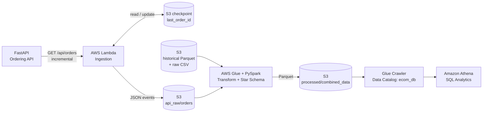

# E-Commerce Analytics Data Platform on AWS

An end-to-end data platform on AWS. It **ingests new orders incrementally** from a REST API, **merges them with historical data** in an S3 data lake, models everything into a **star schema** with PySpark, and serves analytics through **AWS Glue Data Catalog and Amazon Athena**.

## Architecture



## Tech Stack

| Layer | Tools |
|---|---|
| Source API | Python, FastAPI, Pydantic, ngrok |
| Ingestion | AWS Lambda (Python, boto3, urllib3) |
| Data lake | Amazon S3 (raw JSON/CSV → processed Parquet) |
| Processing | AWS Glue (PySpark, Spark 3.3) |
| Catalog | AWS Glue Crawler + Glue Data Catalog |
| Analytics | Amazon Athena (SQL, window functions) |

## Pipeline Stages

### 1. Source: Ordering API (`ordering_api.py`)
A FastAPI service that simulates a live e-commerce system.
- `POST /orders` creates an order. It validates the customer, product, stock and payment method, applies discounts, 14% tax and shipping, simulates payment (95% success rate), and creates a shipment.
- Each order is stored as one **nested JSON event** with `metadata`, `order`, `order_details[]`, `payment`, `shipment` and `summary`.
- `GET /api/orders?from_order_id=&limit=` is a paginated incremental endpoint for the ingestion layer.
- The service is exposed publicly through ngrok so Lambda can reach it.

### 2. Ingestion: AWS Lambda (`lambda_Function.py`)
- **Incremental loading** with a checkpoint (`last_order_id.txt`) stored in S3.
- Each run reads the checkpoint, requests only newer orders from the API (in batches of up to 1,000), validates every event's structure, writes each order to `s3://<bucket>/api_raw/orders/order_<id>.json`, then advances the checkpoint.
- It skips already-processed IDs, and S3 keys are deterministic (one per order ID), so a re-run never creates duplicates.
- Sample run: 220 new orders ingested in about 15 seconds on 128 MB of memory.

### 3. Transformation: AWS Glue + PySpark (`the final notebook.ipynb`)
- **Reads** historical Parquet data (50K orders, 100K order lines, 45K payments, 40K shipments), raw CSV master data, and the new API JSON events.
- **Flattens nested JSON** with `explode()` on `order_details` and extracts the payment and shipment structs.
- **Standardizes** column names, data types and status values so new data matches the historical schema, then **merges** old and new data with `unionByName`.
- **Deduplicates** payments and shipments against historical data with `left_anti` joins.
- **Builds a star schema** with surrogate keys:

| Dimensions (10) | Facts (6) |
|---|---|
| `dim_customer`, `dim_product`, `dim_category`, `dim_department`, `dim_supplier`, `dim_employee`, `dim_shipper`, `dim_date`, `dim_payment_method`, `dim_order_status` | `fact_order`, `fact_order_detail`, `fact_payment`, `fact_shipment`, `fact_customer_sales`, `fact_product_sales` |

- **Business metrics** include gross sales, discount, net sales, cost, profit, delivery duration and order value category (High, Medium or Low).
- **Writes** all 16 tables to S3 as Parquet.

### 4. Data Quality Checks
Built into the notebook before the write step:
- Duplicate checks on every dimension's business key
- Grain checks on every fact table
- Null foreign key checks
- Referential integrity checks (`left_anti` joins from each fact to its dimensions)

### 5. Catalog and Analytics: Glue + Athena (`ecommerce_analytics.sql`)
A Glue Crawler registers the Parquet tables in the `ecom_db` database. Athena then runs 15 analytical queries, including:
- KPIs: total sales, orders, customers, units sold and profit
- Monthly sales and profit trends
- Sales by category, product and customer, plus top-10 rankings
- Order status, payment method and shipment delivery performance
- **Window functions:** running totals, month-over-month growth, `RANK()` of products within each category

## Screenshots

### 1. Ordering API (FastAPI)


### 2. Lambda incremental ingestion
220 new orders ingested, with the checkpoint moving from `2000000` to `2000220`.


### 3. Raw JSON events in S3


### 4. Star schema written to S3 as Parquet


### 5. Glue Crawler and Data Catalog


### 6. Athena analytics
Top products in each category with `RANK()`:


## Project Structure

```
.
├── ordering_api.py               # FastAPI source system
├── lambda_Function.py            # Incremental ingestion to S3
├── the final notebook.ipynb      # PySpark transformations + star schema
├── ecommerce_analytics.sql       # Athena analytics queries
├── README.md
└── images/                       # Screenshots of each pipeline stage
```

## How to Run

1. **Start the API:** `uvicorn ordering_api:app --port 8000`. Expose it with `ngrok http 8000`, then create test orders with `POST /orders/test-batch/{n}`.
2. **Deploy the Lambda:** set the `API_URL` environment variable to `<ngrok-url>/api/orders`, and give the role S3 read and write access to the bucket.
3. **Invoke the Lambda** to pull new orders into `s3://<bucket>/api_raw/orders/`.
4. **Run the PySpark notebook** as an AWS Glue interactive session to build the star schema in `processed/combined_data/`.
5. **Run the Glue Crawler** on `processed/combined_data/` to create the tables in `ecom_db`.
6. **Query in Athena** with the queries in `ecommerce_analytics.sql`.

## Future Improvements

- Schedule the Lambda with Amazon EventBridge, and orchestrate the full pipeline with Step Functions or Airflow
- Batch API events into one partitioned file per run (`dt=YYYY-MM-DD/`) instead of one small file per order
- Partition the fact tables by year and month to reduce the data Athena scans
- Replace full overwrites with incremental merges (Apache Iceberg, Delta Lake or Hudi)
- Load the star schema into Amazon Redshift for BI dashboards
- Define the infrastructure as code with Terraform or AWS CDK

## Configuration

Both the Lambda and the notebook read the bucket name from configuration, not from the code:

| Component | Setting |
|---|---|
| Lambda | Environment variables `API_URL` and `BUCKET` |
| Notebook | Set `BUCKET` in the first cells to your own bucket name |

